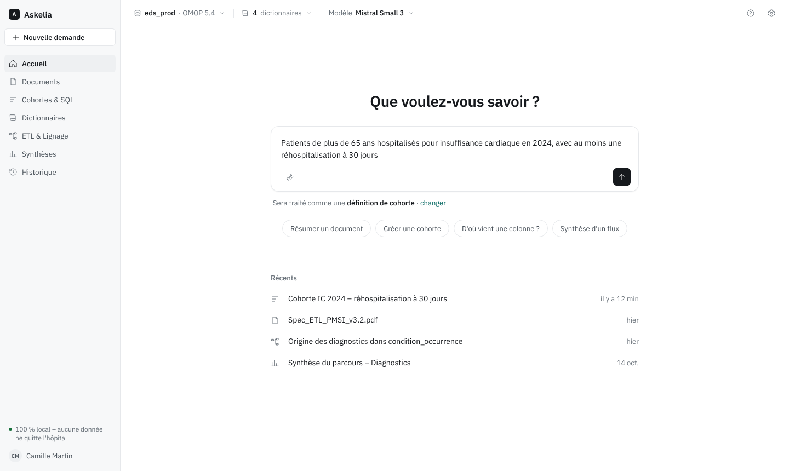
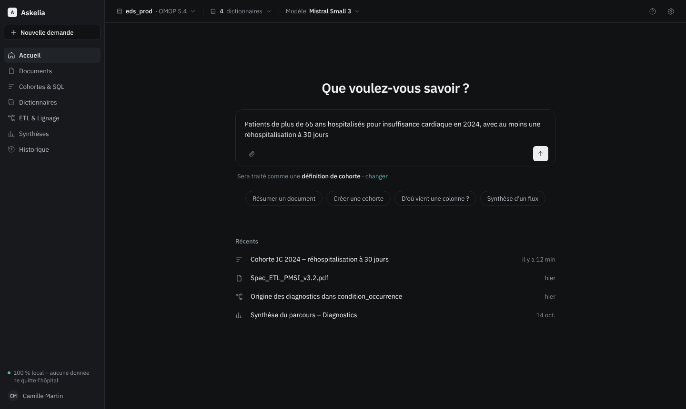
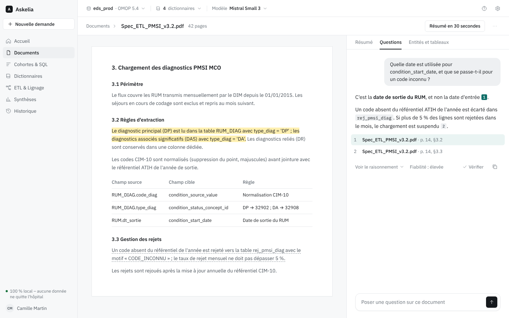
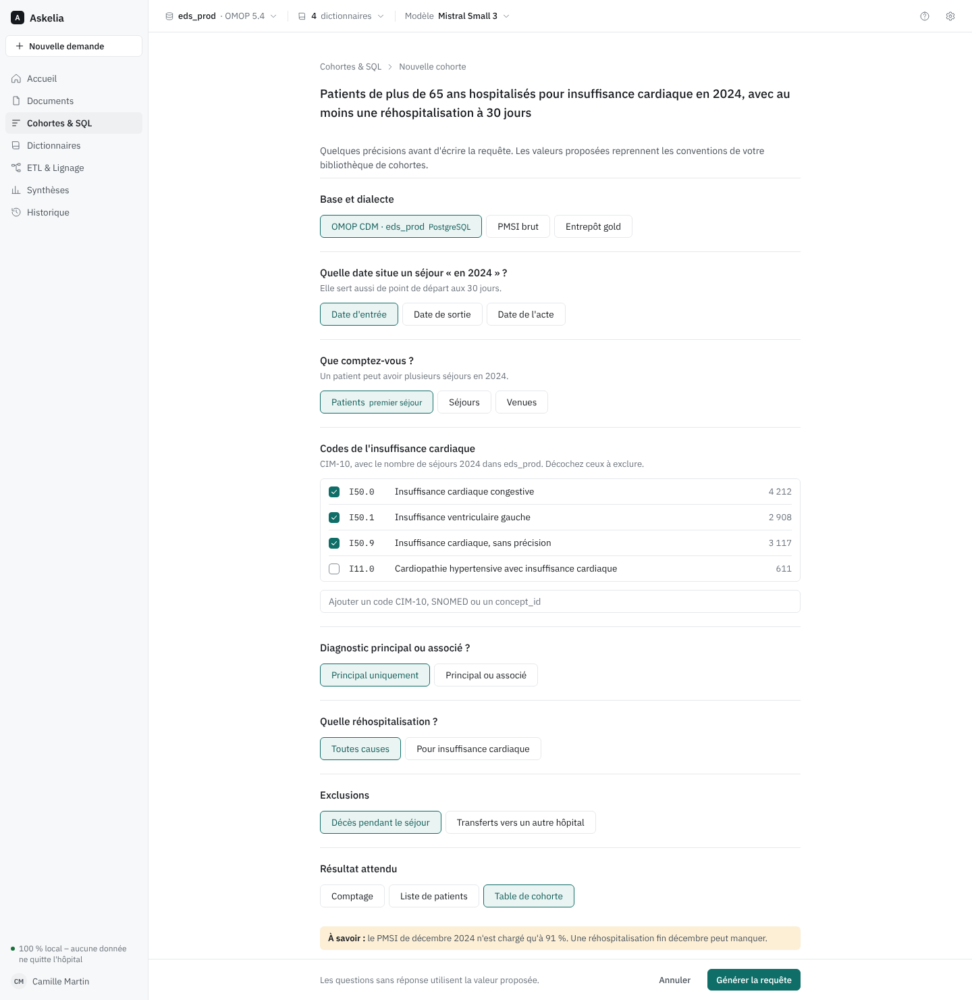
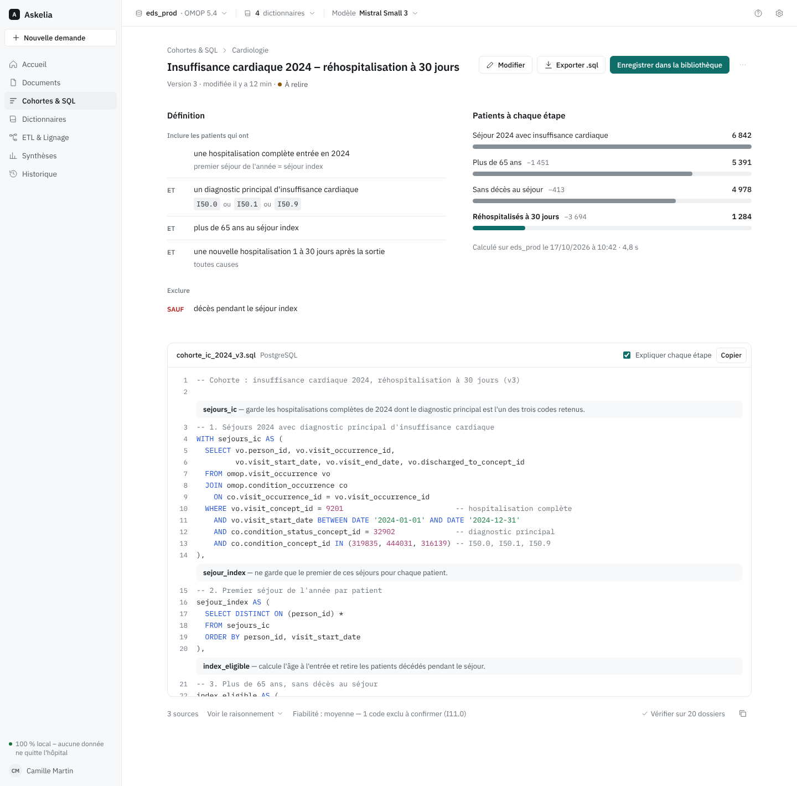
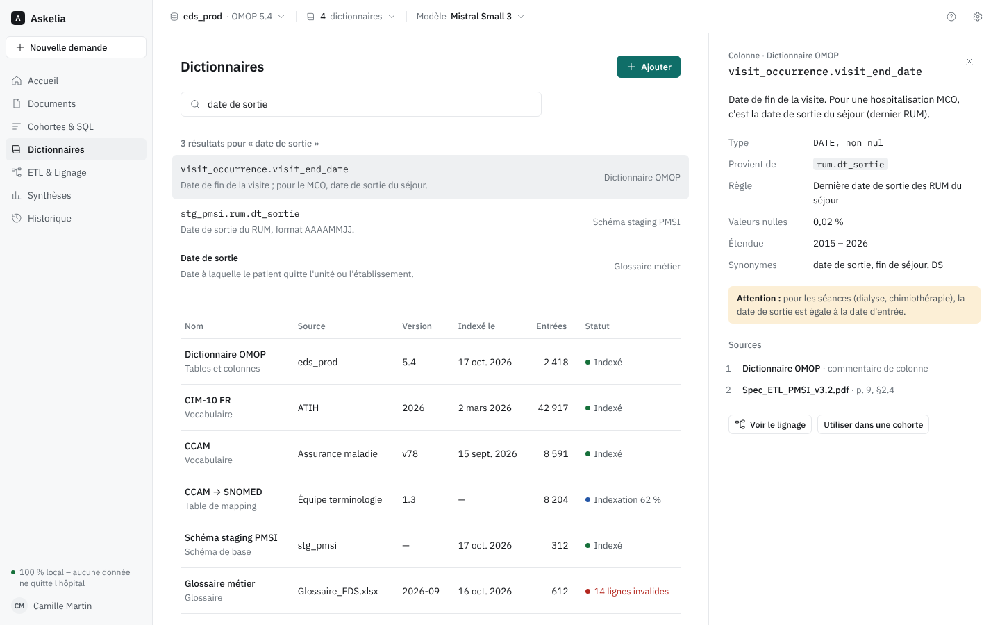
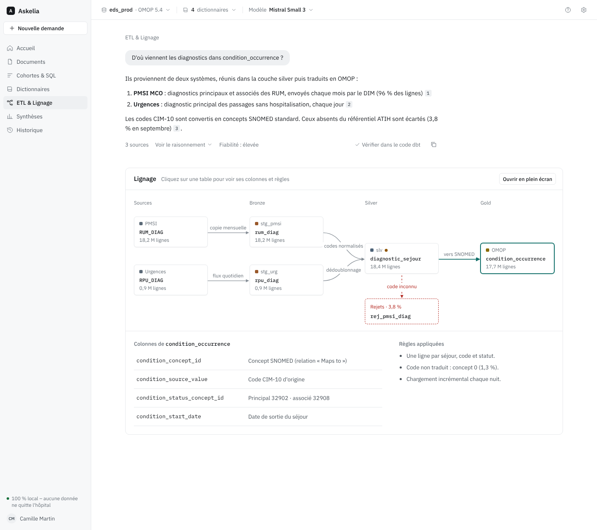
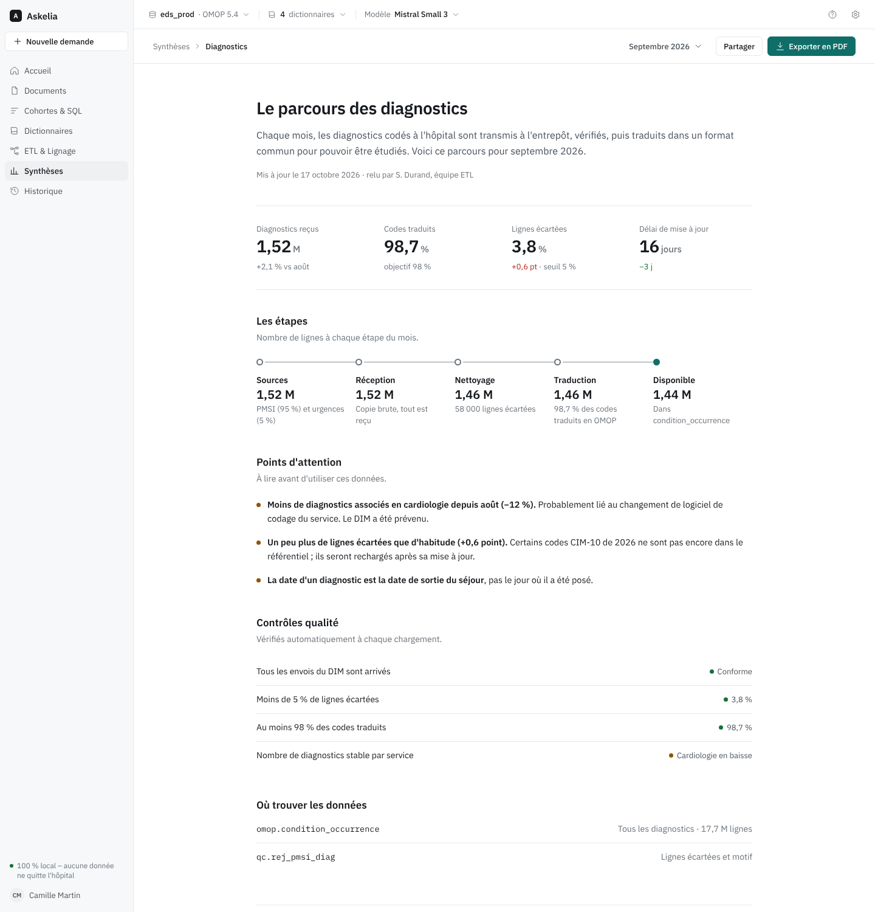

# Design de l'interface Askelia

Askelia est l'assistant IA interne de l'entrepôt de données de santé du CHU. Il tourne entièrement en local et s'adresse aux data engineers, aux data managers et aux chercheurs.

Ce dossier rassemble la documentation de son interface : les principes visuels, les tokens, les composants et les maquettes des sept écrans.

## Contenu

| Chemin | Contenu |
| --- | --- |
| [`askelia/README.md`](askelia/README.md) | Guide de style : principes, rédaction, couleur, typographie, espacement, mise en page, iconographie |
| [`askelia/tokens.json`](askelia/tokens.json) | Tokens : couleurs (thèmes clair et sombre), typographie, espacements, rayons, ombres |
| [`askelia/components/`](askelia/components/) | Composants : une fiche `README.md` et un aperçu `preview.html` par composant |
| [`askelia/components/bundle.js`](askelia/components/bundle.js), [`bundle.css`](askelia/components/bundle.css) | Code des composants (React 18, sans dépendance) et feuille de styles |
| [`askelia/components/index.d.ts`](askelia/components/index.d.ts) | Signatures des composants |
| [`captures/`](captures/) | Captures des sept écrans à 1440 px |

La même documentation est consultable en ligne, avec les aperçus interactifs : https://claude.ai/artifact/AN7AfhxAUf3E3mp2tWruKM (accès privé, à partager depuis la page).

## Principes

- **Une seule action principale par écran.** Les autres actions sont des boutons neutres, des liens ou un menu « … ».
- **Peu de cadres.** Les zones sont séparées par l'espace et par des filets, pas par des cartes empilées.
- **Couleur réservée au sens.** L'interface est en gris neutres. Le bleu-vert sert à l'action principale, à la sélection et au focus. Un statut s'affiche comme un point coloré suivi d'un mot.
- **Transparence discrète.** Chaque réponse factuelle porte des appels de note numérotés et la liste de ses sources. Elle indique aussi sa fiabilité en un mot, garde son raisonnement replié et propose une action « Vérifier ».
- **Indicateur permanent** en bas de la barre latérale : « 100 % local – aucune donnée ne quitte l'hôpital ».

Le détail de ces règles est dans le [guide de style](askelia/README.md).

## Composants

| Composant | Rôle |
| --- | --- |
| [`QuestionCard`](askelia/components/QuestionCard/README.md) | Question de clarification avant la génération d'une requête : choix, codes à cocher, champ libre |
| [`Citation`](askelia/components/Citation/README.md) | Source numérotée d'une affirmation ; un clic surligne le passage dans le document |
| [`AnswerMeta`](askelia/components/AnswerMeta/README.md) | Pied de réponse : sources, raisonnement replié, fiabilité, bouton « Vérifier » |
| [`SqlEditor`](askelia/components/SqlEditor/README.md) | Éditeur SQL avec coloration et une explication en français avant chaque étape |
| [`LineageNode`](askelia/components/LineageNode/README.md) | Table dans un schéma de lignage : couche, nom, volume |
| [`KpiCard`](askelia/components/KpiCard/README.md) | Chiffre clé avec son libellé et de quoi le juger |
| [`StatusBadge`](askelia/components/StatusBadge/README.md) | Statut : un point coloré suivi d'un mot |

## Écrans

### 1. Accueil

Une seule barre de saisie. La demande est orientée automatiquement vers le bon module, et les éléments récents sont listés en dessous.

Le même écran en thème sombre :

### 2. Lecture d'un document

Le document s'affiche à gauche. À droite, des onglets Résumé, Questions et Entités. Cliquer sur un appel de note surligne le passage cité.

### 3. Générateur de cohorte : précisions

Avant d'écrire le SQL, l'assistant pose ses questions : base et dialecte, date de référence, niveau d'analyse, codes, critères, résultat attendu. La valeur proposée est déjà cochée, et un seul bouton génère la requête.

### 4. Générateur de cohorte : résultat

L'écran montre la définition de la cohorte (ET / OU / SAUF) et le nombre de patients restant à chaque étape. Le SQL suit, expliqué étape par étape, avec les actions Modifier, Exporter et Enregistrer dans la bibliothèque.

### 5. Dictionnaires

Une recherche dans tous les dictionnaires à la fois et le tableau des sources indexées (version, date, nombre d'entrées, statut). La fiche détaillée d'un terme s'ouvre dans un panneau latéral.

### 6. ETL et lignage

Une réponse sourcée, puis le schéma du flux : sources → bronze → silver → gold (OMOP), avec la transformation écrite sur chaque flèche. Un clic sur une table affiche ses colonnes et ses règles.

### 7. Synthèse du parcours

Un rapport lisible par un non-technicien, exportable en PDF : chiffres clés, étapes, points d'attention, contrôles qualité et tables finales.

## Remarques

- Toutes les données des maquettes sont fictives : volumes, codes, identifiants de concepts, noms de personnes.
- Les maquettes sont conçues pour des écrans de 1440 px et plus. Le comportement sur tablette est décrit dans le guide, mais il n'a pas encore de maquette.
- Pour ouvrir un aperçu (`preview.html`) hors de la page en ligne, il faut lui fournir les variables CSS des tokens, `bundle.css`, React 18 et `bundle.js`.
